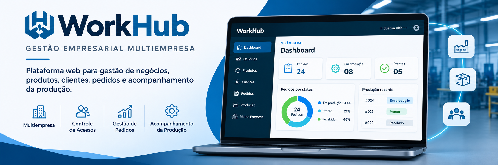

# WorkHub

O WorkHub é uma plataforma web multiempresa para organizar empresas, produtos, clientes, pedidos e produção. É um projeto acadêmico relacionado à ODS 9 — Indústria, Inovação e Infraestrutura.

  

## Índice

- [Arquitetura](#arquitetura)
- [Funcionalidades](#funcionalidades)
- [Multiempresa e permissões](#multiempresa-e-permissões)
- [Como executar](#como-executar)
- [Segurança](#segurança)
- [Stack](#stack)
- [Estrutura do projeto](#estrutura-do-projeto)
- [Decisões de arquitetura](#decisões-de-arquitetura)

## Arquitetura

O WorkHub é um monólito MVC simplificado em PHP 8.3 procedural. O Apache encaminha as rotas para a aplicação; controllers coordenam as requisições, models acessam o MySQL 8.4 com MySQLi e views renderizam as páginas com Bootstrap. O Docker Compose executa a aplicação e o banco localmente.

~~~text
Navegador
    |
    v
Apache + PHP 8.3
    |
    v
public/index.php -> controller/router.php
    |
    v
Controller -> Model (MySQLi) -> MySQL 8.4
    |
    v
View (HTML + Bootstrap)
~~~

A área pública concentra o cadastro e a entrada; a área empresarial é vinculada à empresa da sessão; e a administração da plataforma possui autenticação própria. Para a apresentação acadêmica em sala, a AWS EC2 é a infraestrutura escolhida para hospedar e disponibilizar a demonstração.

## Funcionalidades

| Módulo | Descrição |
| --- | --- |
| Cadastro de empresas | Registra a empresa e seu primeiro responsável, com perfil `PROPRIETARIO`. |
| Autenticação | Controla o acesso empresarial e administrativo por sessão. |
| Usuários | Gerencia gerentes e funcionários da própria empresa. |
| Produtos | Cadastra, consulta e atualiza o catálogo da empresa. |
| Clientes | Mantém clientes e seu histórico de pedidos. |
| Pedidos | Registra itens, totais, prazos, filtros e detalhes dos pedidos. |
| Produção | Acompanha status, prazos e cancelamentos autorizados. |
| Dashboard | Exibe indicadores, pedidos recentes e alertas de prazo. |
| Minha Empresa | Atualiza os dados cadastrais da empresa. |
| Administração da plataforma | Consulta empresas e permite ativá-las ou desativá-las. |

### Fluxo de pedidos

~~~text
RECEBIDO -> EM_PRODUCAO -> PRONTO -> ENTREGUE
CANCELADO: permitido enquanto o pedido não estiver em estado terminal
~~~

Conforme a RN42, usuários autorizados podem avançar diretamente para estados posteriores; não é obrigatório passar por todos os estados intermediários. Cada alteração registra o status anterior, o novo status, o responsável e a data no histórico do pedido.

## Multiempresa e permissões

Os dados empresariais são isolados logicamente por `empresa_id`. O contexto da sessão é validado em requisições protegidas, e controllers e models aplicam esse vínculo nas consultas e operações. `ADMIN_PLATAFORMA` é uma identidade separada para a administração global.

| Ação | PROPRIETARIO | GERENTE | FUNCIONARIO | ADMIN_PLATAFORMA |
| --- | --- | --- | --- | --- |
| Acessar dashboard, produtos, clientes e pedidos da empresa | Sim | Sim | Sim | Não |
| Consultar detalhes de cliente e histórico de pedidos | Sim | Sim | Sim | Não |
| Gerenciar usuários da empresa | Sim | Não | Não | Não |
| Atualizar Minha Empresa | Sim | Não | Não | Não |
| Cadastrar, editar ou ativar/desativar produtos e clientes | Sim | Sim | Não | Não |
| Criar pedido e avançar seu status | Sim | Sim | Sim | Não |
| Editar ou cancelar pedido | Sim | Sim | Não | Não |
| Consultar e ativar/desativar empresas globalmente | Não | Não | Não | Sim |

## Como executar

### Pré-requisitos

- [Git](https://git-scm.com/)
- Docker Desktop ou Docker Engine com Docker Compose

Clone o projeto e entre na pasta:

~~~bash
git clone https://github.com/LS-PLuka/WorkHub.git
cd WorkHub
~~~

Copie a configuração local já preenchida:

Linux/macOS:

~~~bash
cp .env.example .env
~~~

PowerShell:

~~~powershell
Copy-Item .env.example .env
~~~

Inicie a aplicação:

~~~bash
docker compose up -d --build
~~~

Abra [http://localhost:8080](http://localhost:8080). O Docker executa PHP/Apache e MySQL; quando o volume do banco é criado pela primeira vez, o schema é inicializado automaticamente.

- `git clone` baixa o projeto.
- `cd WorkHub` entra na pasta do projeto.
- Copiar `.env.example` prepara a configuração local.
- `docker compose up -d --build` constrói e inicia os serviços em segundo plano.

Comandos úteis:

~~~bash
docker compose ps
docker compose down
~~~

O primeiro verifica os contêineres. O segundo interrompe a aplicação e preserva os dados do volume do banco.

### Acesso administrativo local

Na primeira inicialização, o administrador local é criado automaticamente. Acesse [http://localhost:8080/administracao/entrar](http://localhost:8080/administracao/entrar) com:

- E-mail: `admin@admin.com`
- Senha: `teste123`

São credenciais fictícias destinadas ao ambiente acadêmico local. A senha é armazenada com bcrypt, e o bootstrap é idempotente: ele não altera administradores existentes.

As configurações de demonstração e produção continuam separadas em `compose.demo.yaml` e `compose.prod.yaml`, com seus respectivos ambientes e proteções.

## Segurança

- Senhas com bcrypt.
- Sessões PHP com `HttpOnly`, `SameSite=Lax`, regeneração no login e expiração por inatividade.
- Proteção CSRF em formulários mutáveis.
- RBAC no backend e isolamento multiempresa por `empresa_id`.
- Consultas MySQLi preparadas e charset `utf8mb4`.
- Rate limiting de tentativas de login.

## Stack

| Tecnologia | Responsabilidade |
| --- | --- |
| PHP 8.3 | Aplicação procedural e regras de negócio. |
| Apache 2.4 | Servidor web e encaminhamento de rotas. |
| MySQL 8.4 | Banco de dados relacional. |
| MySQLi | Consultas preparadas e acesso procedural ao MySQL. |
| Bootstrap 5 | Layout e componentes das views. |
| HTML5, CSS3 e JavaScript | Interface e interações visuais. |
| Docker Compose | Ambiente local com PHP/Apache e MySQL. |
| AWS EC2 | Infraestrutura prevista para a demonstração acadêmica. |

## Estrutura do projeto

~~~text
WorkHub/
├── config/        # Conexão, sessão e configuração
├── controller/    # Router e controllers
├── model/         # Consultas MySQLi
├── view/          # Views públicas, empresariais e administrativas
├── public/        # Entrada HTTP e ativos
├── database/      # Schema inicial
├── docker/        # Apache, entrypoint e Caddy
├── scripts/       # Bootstrap e verificações
├── docs/          # Referências de implantação
├── compose.yaml   # Ambiente local
├── compose.demo.yaml
├── compose.prod.yaml
└── Dockerfile
~~~

## Decisões de arquitetura

- **Monólito MVC simplificado:** adequado ao escopo acadêmico e à entrega integrada de páginas, regras e persistência, sem complexidade de serviços distribuídos.
- **PHP procedural com MySQLi:** abordagem direta e legível, com consultas preparadas em vez de uma camada ORM.
- **MySQL relacional:** chaves estrangeiras e vínculos compostos contribuem para a consistência entre empresas, usuários, clientes, produtos e pedidos.
- **Isolamento lógico multiempresa:** `empresa_id` acompanha contexto, consultas e relacionamentos operacionais.
- **Sessões PHP e RBAC:** sessão identifica o usuário e perfis delimitam as operações permitidas.
- **Docker Compose:** padroniza PHP/Apache e MySQL sem instalação local dessas dependências.
- **Desativação lógica:** empresas, usuários, produtos, clientes e pedidos possuem situação ativa em vez de exclusão física nos fluxos de negócio.
- **Histórico de status:** cada alteração de pedido é registrada para acompanhar a produção e identificar o responsável.

Desenvolvido por [Pedro Luka](https://github.com/LS-PLuka) · [LinkedIn](https://linkedin.com/in/pedroluka-dev)
